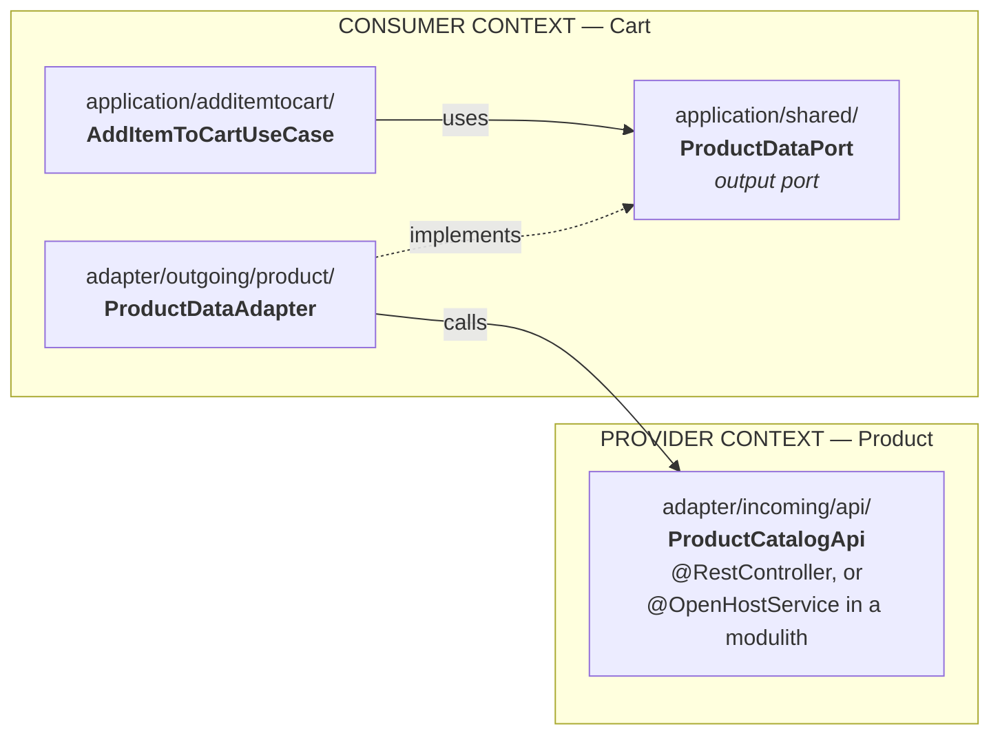
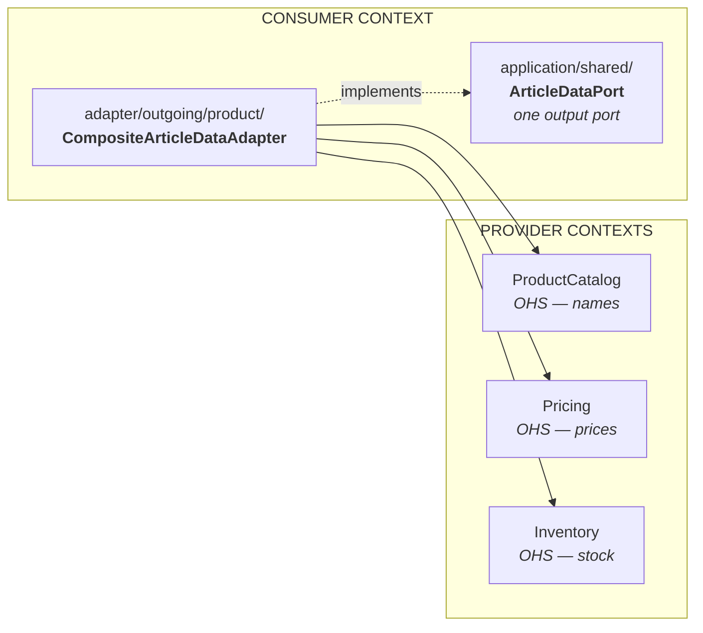
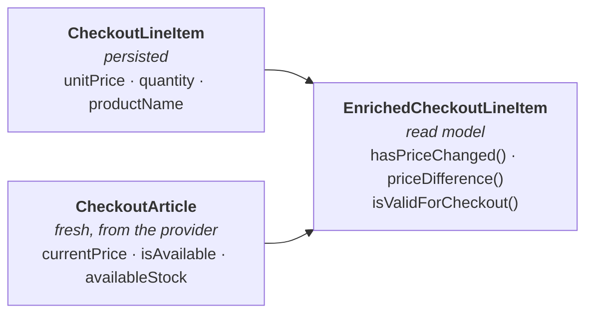
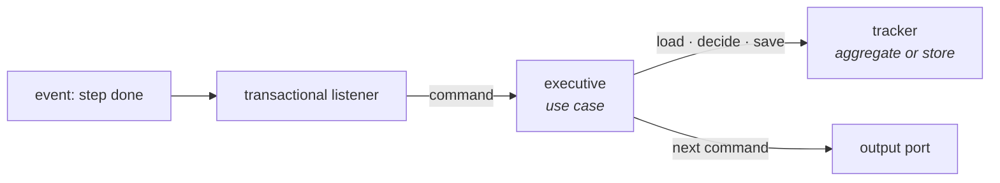

# Integration Patterns

## Same Bounded Context
- Direct method calls within aggregate
- Domain events for cross-aggregate communication
- Use case coordinates multiple aggregates
- Eventual consistency between aggregates
- A reaction to a domain event drives a use case after the commit — see [Reacting to an event](#reacting-to-an-event)

## Different Bounded Contexts
- Anti-Corruption Layer for external models
- Open Host Service for synchronous queries
- Domain events via message broker
- REST API with DTOs
- Shared Kernel (minimal, coordinated)

## A Bounded Context Is a Deep Module

A bounded context is a *deep module* in the sense of Ousterhout (*A Philosophy of Software
Design*): a lot of implementation behind a deliberately small interface. Its public surface is
the set of input ports, the integration events it publishes and the trigger interfaces it
defines for its suppliers — nothing else. Aggregates, use cases, adapters and read models
stay inside. The architecture rules make this depth enforceable rather than a convention:
no raw import crosses a context boundary, and every published relationship is declared on
`package-info.java` and verified.

Depth is measured at the context, not at the package. The many small use-case packages
inside a context are its interior, not shallow modules of their own. The payoff is the same
for every reader of the code: a person — or a coding agent without memory of previous
sessions — understands a context from its ports and records alone and touches the interior
only when working there.

## Declaring Context Relationships in Code

Context-map relationships are declared on the bounded context's `package-info.java`, next to
`@BoundedContext`. The declaration is the single source of truth: architecture tests verify that the
declared relationships match the actual dependencies, and the human-readable context map (table +
diagram) is rendered from the same annotations — an **executable context map** that cannot drift.

```java
// checkout/package-info.java
@BoundedContext(name = "Checkout", description = "Checkout process, order placement, payment orchestration")
@Upstream(
    context = "product",
    translation = Upstream.Translation.ANTI_CORRUPTION_LAYER,
    via = Upstream.Consumes.API,
    rationale = "Product data is translated into checkout's own article types")
@Upstream(
    context = "cart",
    translation = Upstream.Translation.CONFORMIST,
    via = Upstream.Consumes.EVENTS,
    rationale = "CartCheckedOutEvent is consumed as published, no translation needed")
@ExternalUpstream(
    name = "Payment Provider",
    translation = Upstream.Translation.ANTI_CORRUPTION_LAYER,
    interaction = ExternalUpstream.Interaction.OUTBOUND,
    protocol = "REST",
    contractPackages = "..checkout.adapter.outgoing.payment..")
package com.company.project.checkout;
```

| Annotation | Declares | Key attributes |
|------------|----------|----------------|
| `@Upstream` (repeatable) | this context is **downstream** of `context` | `translation` = `ANTI_CORRUPTION_LAYER` \| `CONFORMIST`; `via` = `API` \| `EVENTS`; `status` = `IMPLEMENTED` \| `PLANNED`; `rationale` |
| `@ExternalUpstream` (repeatable) | an **external system** the context talks to | `interaction` = `OUTBOUND` \| `INBOUND`; `protocol`, `exchanges`, `contractPackages` |
| `@Partnership` (repeatable) | mutual, coordinated evolution with `context` | `rationale` |
| `@OpenHostService` | this adapter is a published API for other contexts | on the adapter class, not the package |
| `@SharedKernel` | the package is the shared kernel | on `package-info.java` |

**What `translation` is, and what it is not.** It states how *this* context protects its own
model — `ANTI_CORRUPTION_LAYER` or `CONFORMIST` — and nothing else. Three questions are
easily collapsed into one and must not be:

| Question | Where it is answered | Values |
|---|---|---|
| How does the downstream protect its model? | `translation` on `@Upstream` | ACL, Conformist |
| How does the upstream publish? | `@OpenHostService` on the published type, and the `api` / `events` packages themselves | Open Host Service, Published Language |
| How do the two teams work together? | nowhere in the code — prose, or `rationale` | Customer/Supplier, Partnership, Separate Ways |

One relationship normally answers all three at once: a context consumes another through
its Open Host Service, translates it with an Anti-Corruption Layer, and the two teams work
as Customer/Supplier. Writing "Customer/Supplier" where the declaration says
`ANTI_CORRUPTION_LAYER` is not a contradiction but a category error, and it costs the
mechanical check: `DCA-MAP-008` demands a translation site for every declared channel, and
an organisational pattern names no site.

Rules the declarations enable (see [ArchUnit Governance](../topics/archunit-governance.md)):

- Every cross-context dependency in code must be covered by an `@Upstream`/`@Partnership` declaration
  (undeclared coupling fails the build).
- Every declared relationship with `status = IMPLEMENTED` must have a matching dependency (dead
  declarations fail the build); `PLANNED` relationships are exempt.
- `ANTI_CORRUPTION_LAYER`: the upstream's contract types must stay inside the matching outgoing
  adapter (or event consumer) — they never leak into application or domain.
- `CONFORMIST`: the upstream's contract types may be used as-is in the application layer, but still
  never reach the domain layer — conformism does not suspend domain purity.
- Declarations must be well-formed: target context exists, never the declaring context itself, unique
  per context and channel, `@Partnership` symmetric on both sides, and consistent with Spring Modulith
  `allowedDependencies` where used.

## Open Host Service Pattern

For synchronous cross-context queries, use the Open Host Service pattern.



The use case knows the port, never the Open Host Service.

### Provider: REST API (Canonical)

The canonical DDD Open Host Service is a **REST API** with a published language:

```java
// adapter/incoming/api/ProductCatalogApi.java
@RestController
@RequestMapping("/api/v1/products")
public class ProductCatalogApi {

    private final GetProductByIdInputPort getProductUseCase;

    public record ProductInfoDto(String id, String name, BigDecimal price, int stock) {}

    @GetMapping("/{productId}")
    public ResponseEntity<ProductInfoDto> getProduct(@PathVariable String productId) {
        return getProductUseCase.execute(new GetProductQuery(ProductId.of(productId)))
            .map(r -> new ProductInfoDto(r.productId().value(), r.name(), r.price().amount(), r.stock()))
            .map(ResponseEntity::ok)
            .orElse(ResponseEntity.notFound().build());
    }
}
```

### Provider: In-Process Service (Modulith Optimization)

For modulith deployments (single JVM), an in-process service avoids network overhead. It lives in the
context's published `api/` package — the in-process contract, next to `events/` — not in the adapter
tree: an Open Host Service is the *relationship* a context publishes, and the transport (in-process
call, REST, gRPC, MCP) is a detail. The REST variant above is simply the same relationship as an
incoming adapter.

```java
// api/ProductCatalogService.java  (published package of the Product context)
@OpenHostService(context = "Product Catalog", description = "...")
@Service
public class ProductCatalogService {
    private final GetProductByIdInputPort getProductByIdInputPort;  // Use case, NOT repository

    public record ProductInfo(ProductId productId, String name, Price price, int availableStock) {}

    public Optional<ProductInfo> getProductInfo(ProductId productId) {
        var response = getProductByIdInputPort.execute(new GetProductByIdQuery(productId.value()));
        if (!response.found()) return Optional.empty();
        return Optional.of(new ProductInfo(
            productId, response.name(),
            Price.of(Money.of(response.priceAmount(), Currency.getInstance(response.priceCurrency()))),
            response.stockQuantity()
        ));
    }
}
```

**Important:** Like an incoming adapter, the OHS calls **use cases (input ports)**, not repositories directly.

### Consumer: Output Port + Adapter (Same for Both)

The consumer-side pattern is **identical** regardless of transport:

```java
// application/shared/ProductDataPort.java - Consumer defines what it needs
public interface ProductDataPort extends OutputPort {
    record ProductData(ProductId id, Price price, boolean hasStock) {}
    Optional<ProductData> getProductData(ProductId id, int quantity);
}

// adapter/outgoing/product/ProductDataAdapter.java - REST variant
@Component
public class ProductDataAdapter implements ProductDataPort {
    private final RestTemplate restTemplate;  // For REST API

    public Optional<ProductData> getProductData(ProductId id, int qty) {
        var response = restTemplate.getForObject("/api/v1/products/" + id.value(), ProductInfoDto.class);
        if (response == null) return Optional.empty();
        return Optional.of(new ProductData(id, Price.of(response.price()), response.stock() >= qty));
    }
}

// OR: adapter/outgoing/product/ProductDataAdapter.java - In-process variant (modulith)
@Component
public class ProductDataAdapter implements ProductDataPort {
    private final ProductCatalogService productCatalogService;  // In-process OHS

    public Optional<ProductData> getProductData(ProductId id, int qty) {
        return productCatalogService.getProductInfo(id)
            .map(info -> new ProductData(id, info.price(), info.stock() >= qty));
    }
}

// application/additemtocart/AddItemToCartUseCase.java - Uses port only (unchanged)
@Service
public class AddItemToCartUseCase {
    private final ProductDataPort productDataPort;  // NOT ProductCatalogService or RestTemplate

    public AddItemToCartResult execute(AddItemToCartCommand cmd) {
        ProductData data = productDataPort.getProductData(cmd.productId(), cmd.qty())
            .orElseThrow(() -> new IllegalArgumentException("Product not found"));
        // ...
    }
}
```

**Key Point:** Only the adapter implementation changes when migrating from modulith to microservices. Use cases and ports remain identical.

**Rules:**
- ✅ REST API as an incoming adapter, e.g. `adapter/incoming/api/` (canonical OHS over the network; the sub-package is the project's choice)
- ✅ In-process OHS in the context's published `api/` package (modulith optimization)
- ✅ OHS returns DTOs, never domain objects
- ✅ Consumer defines own output port specifying exactly what it needs
- ✅ Consumer's adapter in `adapter/outgoing/{context}/` is the ONLY place that imports OHS
- ❌ Use cases never import OHS directly (violates hexagonal architecture)
- ❌ Application layer never imports from other bounded contexts

> **Note:** For multi-service integration patterns, see [Deployment Patterns](../topics/deployment-patterns.md)

## Composite Adapter Pattern

When a context needs data from **multiple** Open Host Services, use a **Composite Adapter** to aggregate the data in one place.



The consumer's application layer sees one port and one shape of data. That three contexts were
asked, and in which order, is the adapter's business alone.

**Example:**
```java
// adapter/outgoing/product/CompositeArticleDataAdapter.java
@Component
public class CompositeArticleDataAdapter implements ArticleDataPort {

    private final ProductCatalogService productCatalogService;  // OHS
    private final PricingService pricingService;                // OHS
    private final InventoryService inventoryService;            // OHS

    @Override
    public Map<ProductId, ArticleData> getArticleData(Collection<ProductId> productIds) {
        // Bulk fetch from each OHS
        Map<ProductId, PriceInfo> prices = pricingService.getPrices(productIds);
        Map<ProductId, StockInfo> stocks = inventoryService.getStock(productIds);

        Map<ProductId, ArticleData> result = new HashMap<>();
        for (ProductId productId : productIds) {
            Optional<ProductInfo> productInfo = productCatalogService.getProductInfo(productId);
            if (productInfo.isPresent()) {
                result.put(productId, combineData(productId, productInfo.get(),
                    prices.get(productId), stocks.get(productId)));
            }
        }
        return result;
    }
}
```

**Rules:**
- ✅ Composite adapter is the **ONLY** place that imports from multiple OHS
- ✅ Aggregates data from multiple sources into context-specific DTO
- ✅ Use cases depend on port interface, not the adapter
- ✅ Isolates cross-context coupling to adapter layer
- ❌ Use cases never import OHS directly

## Domain services over supplied facts

An aggregate answers questions about its own state. When a calculation combines facts from other aggregates or
contexts, the use case retrieves them through output ports and passes immutable snapshots to a domain service.
Moving a lookup behind a resolver/callback parameter does not change who owns the calculation. Neither the aggregate
nor the service receives a repository or remote port. A domain-owned `DomainGateway` is an explicit exception with
an effect and dependency rationale; a pure algorithmic strategy is different from a hidden external lookup.

```java
// Domain service: the use case has already retrieved the article facts.
public final class CartPricing implements DomainService {
    public record Line(ProductId productId, Quantity quantity) implements Value {}

    public Money calculateTotal(List<Line> lines, Map<ProductId, ArticlePrice> facts) {
        Money total = Money.euro(0);
        for (Line line : lines) {
            total = total.add(facts.get(line.productId()).price().multiply(line.quantity().value()));
        }
        return total;
    }
}
```

The service owns the external-fact calculation; the aggregate owns the state transition. Pass the assessment or facts
into that transition, then save and publish in the use case. Presentation enrichment stays a separate value model.
`DCA-TAC-002` checks fields, not semantic responsibility: callback parameters need manual review. No marker proves
that an operation belongs on a particular object.

## Enriched Read Model Pattern

When you need to **combine persisted data with fresh external data** for rich domain logic (e.g., comparing original price to current price), create an **Enriched Read Model**.



The read model answers questions neither side can answer alone. It is a value object in
`{context}/domain/model/`, assembled by a static factory from the aggregate plus a plain carrier of
the external data — fetched through this context's own output port, never by importing the other
context. No identity, no lifecycle, no events: it owns the read rules that span both sides, and
nothing else.

**Example:**
```java
// Enriched line item - combines persisted with current data
public record EnrichedCheckoutLineItem(
    CheckoutLineItem lineItem,     // Persisted at checkout start
    CheckoutArticle currentArticle  // Fresh from external services
) implements Value {

    public Money currentLineTotal() {
        return currentArticle.currentPrice().multiply(lineItem.quantity());
    }

    public boolean hasPriceChanged() {
        return !lineItem.unitPrice().equals(currentArticle.currentPrice());
    }

    public Money priceDifference() {
        return currentArticle.currentPrice().subtract(lineItem.unitPrice());
    }

    public boolean isValidForCheckout() {
        return currentArticle.isAvailable() &&
               currentArticle.availableStock() >= lineItem.quantity();
    }
}

// Enriched cart - collection with business logic
public record CheckoutCart(
    CartId cartId,
    CustomerId customerId,
    List<EnrichedCheckoutLineItem> items
) implements Value {

    public boolean hasAnyPriceChanges() {
        return items.stream().anyMatch(EnrichedCheckoutLineItem::hasPriceChanged);
    }

    public Money calculateCurrentSubtotal() {
        return items.stream()
            .map(EnrichedCheckoutLineItem::currentLineTotal)
            .reduce(Money::add)
            .orElse(Money.zero());
    }

    public boolean isValidForCheckout() {
        return !items.isEmpty() &&
               items.stream().allMatch(EnrichedCheckoutLineItem::isValidForCheckout);
    }

    public List<EnrichedCheckoutLineItem> invalidItems() {
        return items.stream()
            .filter(item -> !item.isValidForCheckout())
            .toList();
    }
}
```

**Benefits:**
- ✅ **Rich domain logic** - "Has price changed?" "Is stock sufficient?"
- ✅ **Single query point** - all validation/calculation in one place
- ✅ **Immutable** - Value Object, safe to pass around
- ✅ **Real-world metaphor** - like a smart shopping cart display

**Note:** An enriched read model is a Value Object, not an Aggregate. It has no lifecycle or events.
Its name follows the domain: `ExtendedCart` and `CartWithCurrentPrices` are equally valid
alternatives to `EnrichedCart`. Neither an `Enriched` prefix nor record syntax defines the
role. Implement `Value` and follow its identity, immutability and equality contracts;
immutable classes with equality are valid too. Enrichment itself is guidance.

## Factory for Cross-Context Assembly

Use a **Factory** to assemble enriched domain objects from data fetched via ports.

```java
// Factory assembles enriched cart from multiple data sources
public class CheckoutCartFactory implements Factory {

    public CheckoutCart create(
        CartId cartId,
        CustomerId customerId,
        List<CheckoutLineItem> lineItems,
        Map<ProductId, CheckoutArticle> articleData
    ) {
        List<EnrichedCheckoutLineItem> enrichedItems = lineItems.stream()
            .map(item -> {
                CheckoutArticle article = articleData.get(item.productId());
                if (article == null) {
                    throw new IllegalArgumentException(
                        "Article data not found for: " + item.productId());
                }
                return new EnrichedCheckoutLineItem(item, article);
            })
            .toList();

        return new CheckoutCart(cartId, customerId, enrichedItems);
    }
}

// Use case uses factory
@Service
public class StartCheckoutUseCase implements StartCheckoutInputPort {
    private final CheckoutArticleDataPort articleDataPort;
    private final CheckoutCartFactory checkoutCartFactory;

    @Override
    public StartCheckoutResult execute(StartCheckoutCommand command) {
        // Fetch data via ports
        List<CheckoutLineItem> lineItems = ...;
        Map<ProductId, CheckoutArticle> articleData =
            articleDataPort.getArticleData(productIds);

        // Factory assembles enriched cart
        CheckoutCart checkoutCart = checkoutCartFactory.create(
            cartId, customerId, lineItems, articleData);

        // Domain validation
        if (!checkoutCart.isValidForCheckout()) {
            throw new ValidationException(checkoutCart.invalidItems());
        }

        // ...
    }
}
```

**Rules:**
- ✅ Factory is in **domain layer** (implements `Factory` marker)
- ✅ Factory is **framework-independent** (no Spring annotations)
- ✅ Application layer fetches data via ports, passes to factory
- ✅ Factory validates all required data is present
- ❌ Factory never fetches data itself (no port injection)


## Optional events and reliable delivery

Events are optional: an aggregate that never registers a fact needs no publisher dependency. `DCA-USE-009`
exempts a save only when the repository type argument and the aggregate's complete hierarchy can be inspected
and no registration is found; unresolved arguments, incomplete scans and undecidable external helpers retain the check.
Contracts belong in the configured `{context}/events/` segment. Translators belong in an outgoing adapter named after its channel — `event/` when delivery is in-process, `messaging/` once transport or an outbox relay lives there;
transport and storage are separate adapters. Schema versions belong in integration-event type metadata.
`DCA-ADV-006/007` use a name heuristic for `schemaVersion`, `eventVersion`, `contractVersion`; a business `version` is allowed.

**What that segment is, and what it is not.** The outgoing messaging segment is the *publishing* side
of this context's own contracts: the translator, the relay that drains the outbox, the
transport client. It is not a bucket for everything with "event" in the name.

A subscriber that forwards a fact to an external system is not part of it, and is not one package at
all. It is two:

- **the subscription** — an incoming adapter, because consuming is arriving traffic. It receives the
  contract, translates it, and calls an input port. It performs no external effect itself.
- **the effect** — an outgoing adapter named after the partner it calls, behind an output port the
  use case declares: `adapter/outgoing/email/`, `adapter/outgoing/erp/`.

The event is the *trigger* of that effect, never its destination. Reading it the other way produces
the class every codebase eventually regrets: a listener that deserialises a message and calls a
third-party API in the same method, with no port between them, no use case that can be tested, and a
retry policy that belongs to two systems at once.

When one broker client serves both directions, it is infrastructure, not an adapter — global or the
module's own, and an outgoing adapter may use both (`DCA-HEX-005`).

An in-process registry may deliver domain events within a context **or integration events between contexts**.
Process location does not determine event classification. Synchronous delivery is atomic only for local resources
participating in the same transaction; a synchronous remote effect cannot be rolled back with the aggregate.
For an external effect, either (A) an own-context transactional listener receives a durably captured domain fact, or
(B) an own-context synchronous translator captures an integration contract consumed asynchronously — the two listener
kinds of [Reacting to an event](#reacting-to-an-event). Cross-context
consumers always use the integration contract. No broker is required to cross a context boundary.

Capture the publication in the aggregate transaction; establish delivery eligibility with commit, then wake the
worker after commit. Recovery reads committed publications even when that wakeup was lost. Track completion per
consumer/effect, retry only unfinished work with bounded attempts and exponential backoff, retain terminal failures
for inspection and deliberate replay. Reuse the original payload and `eventId + consumer + effect` identity.
Provider acceptance is the acknowledgement point. If the process stops after acceptance but before local acknowledgement,
provider-supported idempotency can deduplicate a repeated key; without it, a duplicate external effect remains possible.
For each concrete effect, decide whether rendering/template version and recipient are captured or resolved later;
the event snapshot alone does not decide these. No universal email policy is implied.

`DCA-USE-012` checks transaction-boundary evidence in Java and .NET (`FrameworkTypes.TransactionalAttribute` is empty
by default). Static call graphs cannot prove lambda containment: publishing after an empty boundary in the same
method passes this check. Verify runtime containment and rollback separately. `.NET DCA-USE-013` remains unavailable;
review remote-capable calls and transaction scope explicitly.

## Reacting to an event

A reaction to an event goes **adapter → command → use case**. That holds for a contract from another context
and for a fact this context raised itself. The adapter subscribes, translates the event into a command and calls an
input port. The use case decides, changes one aggregate or calls an output port, and returns a result. A context
that reacts to its own domain event still drives a use case, and that use case runs in a transaction of its own.

### Two listener kinds

Every listener is one of two kinds. The kind decides what it may call.

| | Synchronous listener | Transactional listener |
|---|---|---|
| Runs | inside the transaction that raised the event | after that transaction committed, in a transaction of its own |
| Receives | the event object from the in-process dispatcher | a publication captured in the raising transaction, from the outbox |
| May call | output ports only: the translator that captures an integration event, a metrics port | an input port |
| After a crash | nothing is lost: it ran before the commit or rolled back with it | nothing is lost: the publication is still due and is delivered again |
| Use it for | the translator of path B; anything that needs the request — tenant, locale | every reaction that changes state or performs an external effect |

**A listener that drives an input port is a transactional listener.** A synchronous listener that drives a use case
changes a second aggregate inside the first one's transaction. The boundary of both aggregates is gone, a failure in
the reaction rolls back the fact that caused it, and the reaction runs again on every retry of the request.

Between the two sits an after-commit callback without an outbox: Spring's
`@TransactionalEventListener(AFTER_COMMIT)` on its own, or a hook registered on the commit. It runs after the commit,
but nothing records that it is due. A process that stops between commit and callback loses the reaction. It fits a log
line or a metric. It does not fit a reaction.

### Whose job is the consistency

Whether a second change belongs in the same transaction or in a reaction is a domain question. Evans' tie-breaker,
as Vernon reports it in *Implementing Domain-Driven Design*: if making the data consistent is the job of the user who
runs the use case, keep it transactional — one use case, within the aggregate rules. If it is another user's job, or
the system's, let a reaction do it. The question shows which invariants must hold at once. Most rules that span
aggregates tolerate seconds or minutes; ask the people who know the domain before assuming they do not.

### The outbox, in any form

The guarantee does not depend on a framework. Every outbox has the same parts:

1. **Capture.** The publication is written in the transaction that saves the aggregate. A rollback removes it.
2. **Status per publication and consumer.** Published, processing, completed, failed — per consumer, because two
   reactions to one event succeed and fail independently.
3. **Claim and mark.** A worker claims due publications atomically. A claim older than a threshold counts as stale
   and is claimed again, so a worker that died mid-reaction does not leave the publication stuck.
4. **Wakeup and poll.** The commit wakes the worker; a periodic poll finds what a lost wakeup left behind.
5. **Bounded retry.** Retry with backoff up to a limit. A terminal failure stays in the outbox for inspection and a
   deliberate replay.
6. **At least once.** The same publication can arrive twice. The reaction is idempotent per event id and consumer.

Three forms carry these parts:

- **A framework registry.** Spring Modulith's event publication registry with `@ApplicationModuleListener`, which is
  `@Async` + `@Transactional(REQUIRES_NEW)` + `@TransactionalEventListener`. Its staleness monitor is off by default;
  configure it, or a reaction that hung stays in processing for good.
- **An own table and a worker.** An outbox table beside the aggregates, written by the domain-event publisher, and
  a scheduled worker per consumer that claims rows and drives the input port. No framework needed.
- **A messaging library with durable local queues.** In .NET, Wolverine's durable local queues with its outbox, or the
  outbox of a service bus.

An in-memory outbox has the status machine but not the guarantee. It suits tests and samples, not production.


### A stored event is a format

"Domain events need no versioning" assumes in-process delivery that completes before the transaction ends. Once a
domain event is stored, it is persisted data, and the next deployment reads what the previous one wrote. It needs no
version number — it is read by the same code base, and only until it is delivered — but it needs what a database
migration needs:

- **Tolerant reading.** Unknown fields are ignored, missing ones defaulted. Adding a field is always safe.
- **Two steps for a rename or removal.** Add the new field and keep reading the old one; drop the old one a
  deployment later. Or deploy on an empty outbox: drain it first and check for failed publications.
- **The type name.** Many outboxes record the event's fully qualified class name and the listener's identity. Moving
  the event to another package or renaming the listener method then breaks every pending publication. Drain the outbox
  before such a refactoring, or record a logical name where the outbox lets you.

The less an event carries, the less of its format can change. Ids practically never do.

### An integration event to yourself

An integration event that only its own context consumes, published to make a reaction to an own fact durable, is a
detour. It buys a contract, a version and compatibility rules for a reader that ships with the writer. That is what
domain events are for: capture the domain event in the outbox and subscribe with a transactional listener.

## A process that spans several transactions

Some flows outlive one transaction: they take several steps, wait for an answer, and pick the next step from what
happened. Two patterns carry them, and they are often confused.

| | Saga | Process manager |
|---|---|---|
| Origin | Garcia-Molina and Salem (1987): a long-lived transaction split into steps that commit one by one | Hohpe and Woolf, *Enterprise Integration Patterns*: a central unit that keeps the state of a sequence |
| Its job | **compensate**: when a step fails, a compensating step undoes each earlier one in the business sense | **decide**: the next step depends on the result of the last |
| Starts | implicitly, on one event | explicitly, with an identity of its own |
| Shape | maps events to commands, linear | holds state and branches |

Vlad Khononov's test separates them: a saga that contains `if`-`else` to choose its next action is a process manager.
Vaughn Vernon avoids the word saga and speaks of a *long-running process*. The rest of this section uses process
manager for the deciding kind and saga only where a step is compensated.

**A process manager is a use case and a tracker, not a new layer.** Vernon calls the two parts the *executive* and
the *tracker*:

- **The executive is a use case.** It loads the tracker, decides the next step, records it, and issues the step's
  command through an output port.
- **The tracker holds the progress.** It is an aggregate with the process's identity — or, where the process has no
  invariant of its own, a store. Every event the process reacts to carries that identity.
- **Each step is a reaction.** A step's outcome arrives as an event; a transactional listener turns it into a
  command for the executive (see [Reacting to an event](#reacting-to-an-event)). One step, one transaction.



Vernon's simplest form needs no separate tracker: the aggregate that does part of the work is the tracker, and its
events drive the next step. Use it where one aggregate naturally holds the progress.

A process that runs in one process and needs no durable state — a loop over steps that a person or a job starts and
waits for — is one use case that calls its steps through output ports. That is the
[flow that needs a second operation](./rules.md#a-flow-that-needs-a-second-operation), repeated.

**A saga does not repair a wrong aggregate boundary.** Only the data inside one aggregate is consistent at once.
Two changes that must always hold together belong in one aggregate, not in a saga that compensates the second
when the first fails.
