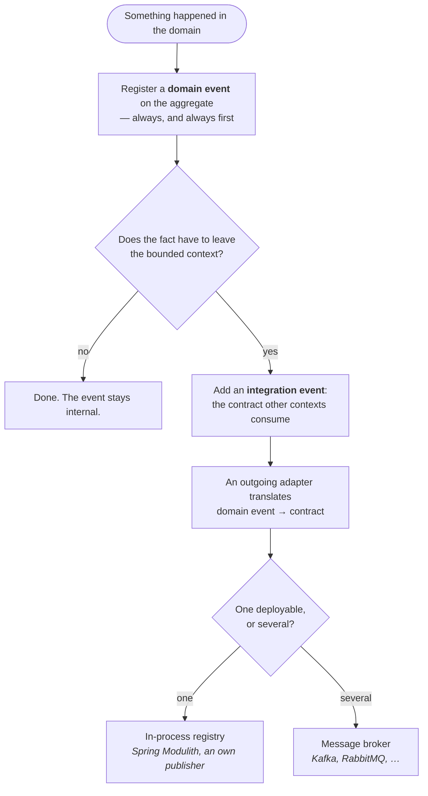
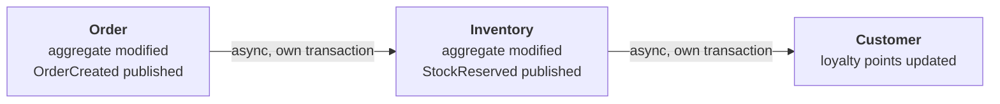

# Rules

## THE FUNDAMENTAL DEPENDENCY RULE

- **All dependencies point inward toward domain**
- Domain has zero outward dependencies
- Domain knows nothing about outer layers
- Application depends only on domain
- Adapters depend on application and domain (through interfaces)
- Infrastructure depends on adapters
- Outer layers know inner layers, never reverse
- Inner layers define interfaces, outer layers implement them

## DOMAIN LAYER RULES

### Entity Rules
- Entity has unique identity
- Identity remains constant throughout lifecycle
- Entities compared by identity only
- Entity can change attributes while keeping identity
- Entity equality based on ID only
- Entity validates its own invariants

### Value Object Rules
- Value Objects are immutable
- Value Objects have no identity
- Value Objects compared by all attributes
- Replace entire Value Object instead of modifying
- Value Objects can be shared freely
- Value Objects validate themselves; state the numeric range and rounding of every monetary value object. Reconstitution, deserialisation and default struct construction must not bypass invalid-state checks.
- **A rule is checked once — in the value object.** A value object built from input refuses everything its rule
  refuses, null included, with the rule's named failure. The incoming adapter hands it the raw value and does not
  check the rule again: no annotation that repeats it, no default that turns an absent value into an empty one.
  A second copy at the edge drifts from the first, and when the rule changes — null becomes valid, the limit grows —
  two places change instead of one. Bean Validation or DataAnnotations belong only where no value object carries the
  rule
- Side-effect-free methods only
- A value from a fixed set — a role, a status, a kind — is a type whose instances are the set. An enum when the
  members are names and nothing more; a value object with one instance per member as soon as a member carries data
  of its own — a code, a label, a rule — so the type reads the same in every language. A string compared against a
  literal in several places is a typo the compiler cannot see, and a class of string constants still lets every
  other string through
- A value object's operations take and return its own kind: a quantity is reduced by a quantity, an amount added
  to an amount. A bare number crossing the method leaves the check of its unit to every caller
- One factory per origin. A value built from input and a value rebuilt from storage are two origins with
  different checks — validated and derived on the way in, taken as given on the way back — and each has its own
  named factory (`fromInput(...)`, `fromStored(...)`). A neutral `of(...)` beside them leaves the caller to guess
  which checks run. A value with one origin keeps its one factory
- **A string, a number or a moment that means something is a value object.** A postal code, a quantity, an
  opening date each carry rules of their own — a format, a range, a meaning — and held as a bare `String`, `int` or
  `Instant` those rules are repeated at every use, or missing. A value of several components holds values too: an
  address holds a `Street`, a `PostalCode` and a `City`, not three strings. Only a wrapper — a value of exactly one
  component — holds the primitive it wraps. An identifier is a typed id, never a bare `UUID`: the type says whose it
  is. What a building block prescribes keeps its type: a domain event's `occurredOn()` and `eventId()` describe the
  event, not the domain, and carry no rules of their own — a business moment such as an opening date or a date of
  birth does, and is a value (`DCA-TAC-025`, experimental)
- **A single yes/no fact is a `boolean` field; a `boolean` parameter is a flag argument.** The aggregate keeps the
  fact to itself, is told to change it and answers when asked:

  ```java
  private boolean completed;

  public void complete() { this.completed = true; }

  public boolean isCompleted() { return completed; }
  ```

  `setCompleted(true)` would let the caller set the state instead of triggering the behaviour, so no domain method
  takes a `boolean`, and nothing outside sets the field. The one exception is the factory that rebuilds a stored
  aggregate — `reconstitute(...)`, or `restore(...)`: it hands the stored fact back to the type that holds it and
  triggers nothing, so it takes the `boolean` as it was stored. The rule recognises that factory by its name; a
  project that names it otherwise configures its own. A `boolean` returned is a question to the object and fine,
  though an aggregate is told what to do rather than asked and then decided about from outside. Three or more
  states, or transitions with rules of their own, are an enum or a value. Facts that hold independently — completed,
  archived, deleted — are separate fields, never one status. A project's glossary may decide otherwise; then the
  glossary applies (`DCA-TAC-025`)

### Aggregate Rules
- Access external objects only through Aggregate Root
- Aggregate Root is an Entity
- Aggregate defines transactional boundary
- Aggregate maintains invariants at all times
- Small aggregates preferred
- Reference other aggregates by ID only, not object reference
- One transaction modifies one aggregate only
- Eventual consistency between aggregates
- Delete aggregate deletes all contained entities
- Never inject repositories or remote services into aggregates. Use cases retrieve facts; domain services calculate over supplied snapshots. A callback parameter does not make external-data responsibility belong on the aggregate.
- Two factories, two purposes: `create(...)` enforces creation invariants and registers the creation event; `reconstitute(...)` rebuilds a stored aggregate from persisted state and registers nothing. Persistence adapters use only the latter — rebuilding through `create` publishes a phantom creation on the next save
- Domain events leave the aggregate through one call, `DomainEventPublisher.publishAndClearEvents(aggregate)`, after the save: dispatch everything, clear only when every listener returned. Iterating `domainEvents()` and calling `publish` per event is not the sanctioned form
- Protect against lost updates with optimistic concurrency: version field on the root, incremented per state change; persistence rejects saves with a stale expected version

### Domain Service Rules
- Domain Service is stateless
- Use when operation doesn't belong to Entity or Value Object
- Use when operation involves multiple domain objects
- Domain Service operates in domain language
- Domain Service is part of domain layer
- No dependencies on application or outer layers
- **A domain service is used by the application and by other domain services only.** The use case calls it
  and carries its outcome in the result. An aggregate, an entity or a value does not call it, nor does a read
  model, an adapter of either direction or the composition root — the composition root only constructs it and
  hands it to a use case. A read model computes on query through the aggregate and its values, never through a
  domain service: a decision belongs to the aggregate, or to the use case that asks the service
  (`DCA-ADV-021`, experimental; `DCA-ADV-019` holds the model's part of it, `DCA-HEX-012` the incoming
  adapter's)

### Domain Event Rules (Internal to Bounded Context)
- Domain Events are immutable
- Domain Events use past tense naming (e.g., OrderCreated, not CreateOrder)
- A domain event's name is the term plus the past participle of the operation's code word in the
  glossary: the operation *place* on an order gives `OrderPlaced`, never `OrderSubmitted` beside it
- Domain Events represent something that happened in the domain
- Domain Events are part of the domain model: `{context}/domain/model/`, or an own
  `{context}/domain/event/` segment once the model package grows. `DCA-ADV-002` requires the
  domain layer, not a segment within it
- Domain Events enable eventual consistency within bounded context
- Domain Events emitted by aggregates during state changes
- Domain Events published by use cases via DomainEventPublisher (Output Port)
- Domain Events handled asynchronously when crossing aggregates: a listener that drives an input port is a
  transactional listener — after the commit, in its own transaction, from a durably captured publication
  ([Reacting to an event](integration-patterns.md#reacting-to-an-event))
- A synchronous listener runs in the publishing transaction and calls output ports only (the translator,
  a metrics port)
- A stored domain event is read by the next deployment: tolerant reading, two-step renames, no version number
- Domain Events must not contain behavior, only data
- Domain Events belong to the domain layer, not adapters

### Integration Event Rules (Cross-Bounded Context)
- Integration Events are DTOs representing domain events for external systems
- Integration Events defined in `{context}/events/` package
- Integration Events use past tense + "Event" suffix (e.g., OrderCreatedEvent)
- Integration Events must be serializable (JSON, Protobuf, Avro)
- Integration Events include: event ID, timestamp, correlation ID; the schema version and
  stable logical name are a **class property** via `@IntegrationEventType(name, version)` —
  never a `version` data field on the instance
- Integration Events created by Event Mappers in outgoing adapters
- Domain events never cross bounded context boundaries directly
- Event Mapper converts domain event → integration event DTO
- Integration Events must be backward compatible (add fields, don't remove)
- Integration Events contain only primitives and value types, no domain objects

**Integration Event Payload Styles** — choose per event type:

| Style | Payload | When |
|---|---|---|
| **Notification** | IDs only — consumer queries back via Open Host Service | Sensitive or large data; query-back doubles as authorization gate |
| **Event-Carried State Transfer** | Relevant state snapshot | Consumer maintains a local cache/replica, avoids chatty query-backs |
| **Domain Fact** | The business fact and its data | Consumer reacts to what happened, no replica needed |

Invariant in all styles: flat, serializable, versioned — never aggregate references.

**Decision Tree: Domain Event or Integration Event?**


**Domain event** — part of the domain model, so `{context}/domain/model/` or an own
`{context}/domain/event/` segment, whichever keeps the package readable. Named in the past
tense (`OrderCreated`), may carry domain objects, carries a timestamp (`DCA-ADV-008`) and no
schema version (`DCA-ADV-007`).

**Integration event** — the published contract. It lives in the context's `events/` segment
(`DCA-STR-007`), carries the `Event` suffix and `@IntegrationEventType(name, version)`
(`DCA-ADV-005`), holds only primitives and serializable types, and is immutable (`DCA-STR-008`).
The schema version belongs to that type metadata, never to the payload (`DCA-ADV-006`).

**The translator** is an outgoing adapter in `adapter/outgoing/event/`: it listens for the domain
event and publishes the contract. Transport and storage are separate adapters again.

**Delivery follows the deployment, not the boundary.** Inside one deployable, an in-process registry
carries the contract across a context boundary — that is what the reference implementation does, and
the boundary is no less real for it. Once the contexts are deployed separately, the same contract
goes over a broker: Kafka, RabbitMQ, whatever the operation runs. The contract does not change, the
adapter behind it does. Nothing above this line depends on the answer.

### Event Publishing Rules
- Use cases call DomainEventPublisher (Output Port) to publish events
- `DomainEventPublisher` is the library port (`hexagonal.port.out`); the application implements it once, in the shared kernel
- DomainEventPublisherAdapter in adapter/outgoing/messaging
- Adapter converts domain events to integration events via mapper
- Message broker (Kafka, RabbitMQ) used for async delivery
- One topic per bounded context or per event type
- Order inside the use case: `save`, then `publishAndClearEvents` — same transaction, never before the save
- The publisher dispatches first and clears the aggregate afterwards; the clear is the acknowledgement that every listener saw the event. A throwing listener fails the use case and leaves the events on the aggregate
- Integration events go through a **transactional outbox**: the publication is written *inside* the aggregate's transaction (Spring Modulith's event publication registry, an outbox table, an in-process stand-in), made eligible atomically with commit and followed by an after-commit wakeup, discarded on rollback. Registering only after commit leaves a crash window between commit and outbox entry
- Delivery is asynchronous and at least once: failures are retried with backoff, permanently failing publications stay visible (`Failed`), outstanding ones are replayed on restart

### Event Consumption Rules
- Event Consumer in adapter/incoming/messaging receives integration events
- Anti-Corruption Layer (ACL) protects domain from external formats
- ACL converts events to domain commands; it belongs to the incoming adapter, and an own
  `acl/` package there is a convention, not a rule
- Event Consumer calls Input Port, never domain directly
- Consuming bounded context maintains its own model
- Eventual consistency between bounded contexts via events
- Assume at-least-once delivery: consumers deduplicate per effect (the effect and the event ID, recorded in the effect's transaction) or make the operation naturally idempotent
- Consumers tolerate out-of-order arrival (check event version/timestamp, never assume sequence)
- Permanently failing events go to a dead-letter queue — never dropped silently
- An event handler modifies at most one aggregate, in its own transaction

### General Domain Rules
- Domain contains business logic only
- Domain is framework-agnostic
- Domain is persistence-agnostic
- Domain is UI-agnostic
- Domain uses pure language features
- Domain can be tested without infrastructure
- Domain reflects business, not database structure
- Ubiquitous Language used throughout domain code
- The context's glossary names the terms **and the operations**, each with the word the code uses; an
  operation's code word is decided by the people who own the domain, not by whoever translates it. A
  read is an operation too: the verb for looking at a read model (`ListEntries` or `ShowEntryList`) is
  named like any other, though no event carries it
- A domain word that can name more than one operation is decided by its effect: what exists before the
  step and after it, and whose state changes. *Create* brings a thing into existence, *add* puts an
  existing one into a collection; *delete* removes it, *cancel* and *archive* keep it with a state. The
  effect decides which aggregate holds the invariants

## APPLICATION LAYER RULES

### Use Case / Application Service Rules
- One use case class per business operation
- A use case is named after an operation of the glossary: its code word plus the term (`PlaceOrder`,
  `CancelOrder`); a verb the glossary does not name is a question, not a choice
- A use case is named after its effect, never after its trigger or its caller: `ArchiveEntry`, not
  `ArchiveEntryOnExpiry` or `ArchiveEntryAfterLogin`. When and by whom it runs is the business of the adapter or
  the consumer that calls it; the same effect reached from a second trigger is the same use case
- An operation speaks the domain, not data access. Neither a use case nor an operation of the context's published
  API is named after a field it writes (`setLimit`, `updateStatus`); it is named after what the change means
  (`RaiseLimit`, `GrantInitialLimit`), with the verb from the glossary
- Use case implements Input Port interface
- Use case orchestrates domain objects
- Use case is thin, delegates to domain
- Use case calls Output Ports for infrastructure
- Use case handles transaction boundaries
- Use case transforms DTOs to domain objects
- Use case transforms domain objects to DTOs
- Use case assembles the `*Result` (static factory, use-case body or `*Assembler`); a result carries values, never aggregate roots or entities (`DCA-USE-015`)
- Command results are small (ids, status, what the caller needs next); the view comes from a query or read model
- A use case that saves an aggregate publishes and clears its domain events after the save (`publishAndClearEvents`, `DCA-USE-009`) — unless the aggregate is proven never to register events
- A query use case carries no transaction and no publisher; it loads and assembles
- A read never creates. A query has no side effect: it does not create, save or publish, and when nothing exists
  it answers *none* — an empty value, not a refusal, where the caller asks whether there is one ("which one, if
  any"); a refusal only where it names a specific thing by id. Find-or-create is a command, called where the
  caller is about to change state; a page or an answer that only shows what exists asks the query
- A bulk operation (delete all, archive everything before a date) is a method on the port — the port is freely extensible beyond `findById`/`save`/`deleteById` — that the use case calls without loading or saving a single aggregate: no domain event, no publisher, a declarative transaction. If other contexts must learn about it, one integration event describes the bulk fact
- A number derived from a list (the count of open items on a list page) is a field of the list query's result, not a use case of its own and not a read model
- No business logic in use cases
- Use case tested with port mocks
- Use case knows nothing about presentation
- Use case knows nothing about persistence details

### Authorization Rules
- Authorization ("may *this caller* do this?") is decided in the use case; the caller arrives as a field of the Command/Query, resolved by the incoming adapter through the identity output port
- A use case that acts on a caller's resource asks the repository a scoped question (`findByIdForCustomer`), never an open lookup followed by a comparison
- A claims-only gate (a role on the token) may sit in the incoming adapter — it reads nothing but the caller
- Say the claims-only gate declaratively, on the route, in the framework's own form: an authorization annotation or
  attribute on the handler (`@PreAuthorize`, `@RolesAllowed`, `[Authorize(Roles = …)]`), or — where the stack has no
  annotations — an extractor in the handler's signature or a layer on its route. A branch on the caller's role inside
  the handler hides the gate from whoever reads the route and renders whatever status the branch writes, where the
  framework would tell an unauthenticated from an unauthorized caller. The project adds no marker of its own beside
  the framework's: the framework's declaration is the declaration. `DCA-HEX-020` (experimental, informational) lists
  an incoming adapter that asks for the caller's roles in its own code. The split is by input: a check that needs
  nothing but the caller sits on the route; a check that needs the stored data — is this yours? — is the use case's
- The domain never knows the caller: no `User` parameter on aggregate methods, no role checks in domain code — invariants only
- The identity port is a project-specific output port in `application/shared/` (context or shared kernel), implemented in the authenticating context's outgoing adapter; the authentication filter enriches every request and gates none
- A use case with no caller (event consumers, scheduled work) checks no caller, but it still loads an owned aggregate
  through the owner its trigger names — an event that asks for an effect on somebody's aggregate carries whose it is.
  Only a path that holds no owner to name uses the unscoped lookup, and documents it
- Ownership is the data-dependent half of authorization ("is this yours?"): it needs the stored aggregate, so it is
  the use case's, never a route annotation's — see *Owned aggregates* below

### Input Port Rules
- Input Port defines use case interface
- Input Port represents business operation
- One Input Port per use case
- Input Port uses domain language
- Input Port accepts Input Data/DTOs
- Input Port returns `<Operation>Result` — in a context that returns its refusals sealed, with one case per expected
  refusal, when the operation has one
- Input Port has no framework dependencies
- Input Port belongs to application layer

### Output Port Rules
- Output Port defines a capability the application needs but does not own — persistence, another context, an external system, messaging, the caller's identity — declared in the application's language and fulfilled by an adapter, in-memory or remote alike
- Output Port is called by a use case — or by an incoming adapter that translates request context into the project's language (the identity port); an interface that only serves adapter mechanics is not a port
- Output Port uses domain language and types
- Output Port implemented by adapters
- Output Port has no framework dependencies
- Output Port belongs to application layer
- Repository interfaces are Output Ports
- Event Publisher interfaces are Output Ports
- Not Output Ports: a transaction boundary (execution semantics), cookies, tokens and sessions (adapter mechanics), a question into the own context dressed as an output port (a query use case or the published API)

### Repository Interface Rules
- Repository interface in application layer
- Repository returns Aggregate Roots only
- One repository interface per Aggregate Root
- Repository provides collection-like interface
- Repository uses domain types, not DTOs
- Repository manages object lifecycle
- Repository implementation in adapter layer
- **Repository reads return copies, never the stored instance** — see below

#### A repository hands out copies

This is where the collection metaphor stops. A `Map`-backed adapter that returns `store.get(id)`
hands out the instance it holds, so a caller who mutates an aggregate has already changed the store
and `save()` is decoration. Against a database the same code loses the change silently, because
loading a row constructs a new object — so the in-memory adapter has been hiding a missing `save()`
in exactly the tests meant to catch it.

Every adapter therefore maps back through the aggregate's `reconstitute` factory: the JDBC/JPA one
because a row leaves it no choice, the in-memory one on purpose (copy on write *and* on read).
Registered-but-unpublished domain events are not carried over — a stored aggregate is a fact, and
re-reading it must not replay what the writer already published.

Keep the adapters honest with a **contract test on the port** that every implementation runs,
including the assertion that an unsaved mutation is invisible to the next reader.

#### Owned aggregates

An aggregate that belongs to someone — a patient's record, a tenant's workspace, a visitor's draft — implements
`Owned<OwnerId>` (`IOwned<TOwnerId>` in C#, `impl Owned { type OwnerId = … }` in Rust), the type argument naming the
owner's id type. Its repository then declares a lookup by the aggregate's id **and** the owner's id —
`findByIdForOwner(id, ownerId)`, named in the context's language — and every use case acting for a caller loads the
aggregate through it. An object loaded by its id alone is reachable by anyone who knows or guesses the id: the
insecure direct object reference of broken access control, OWASP Top 10 **A01**. `DCA-TAC-026` (experimental) checks
the repository side — an owned aggregate whose repository offers only `findById` fails; whether the use case calls the
scoped lookup is a review question, and an aggregate nobody marked is not selected at all.

- **The owner may change, but only explicitly.** `Owned` says "has an owner", not "always the same owner". A
  visitor's draft taken over by the account they sign into changes owner through an operation of the aggregate
  (`takeOverBy(account)`), called after the use case proved the caller's right to it — for example that the guest
  identity named in the signed token is the draft's owner. That proof is use-case logic no marker can verify; its
  tests prove it. Before and after the change, both aggregates are found through their owner.
- **A guest is an owner.** A visitor given a pseudonymous identity on the first request owns what they create; the
  scoped lookup works the same for them. The identity is safe when it comes from a signed token and is not guessable —
  never a value the client names. Registering keeps the identity, so nothing moves.
- **Where `Owned` does not fit.** A system without any identity for guests, where the aggregate's id itself is the
  secret — a long random id in a link, "whoever holds it may" — has no owner to scope a lookup by. Such an aggregate is
  not `Owned`; its safety is the id's unguessability, and that is a deliberate choice, not an omission.

### Transaction Rules
- One transaction per use case execution
- Transaction boundaries managed by use case
- Transaction spans single aggregate modification
- Cross-aggregate changes use eventual consistency

## ADAPTER LAYER RULES

### Input Adapter Rules
- Input Adapter calls Input Port
- Input Adapter uses no infrastructure (`DCA-HEX-004`) — a capability the use case needs is declared as an Output Port there; the adapter may use the identity port to resolve the caller; its own mechanics stay inside the adapter
- Controller extracts data from HTTP request
- Controller creates Input Data/DTO
- The adapter turns raw input into the types the input port takes: an id arrives in the command as the id's
  value type, parsed at the edge (or by the value type's own factory), never as text the use case parses. Text
  that does not parse is a malformed call the adapter answers itself; the use case never sees it
- The adapter checks the shape of the input, never a rule a value object carries. Shape is what the protocol
  decides: is the body JSON, does a number or an id parse, is a path segment there. A rule is what a domain expert
  could change: length, blank, range, a format with a meaning. A field the request leaves out reaches the value
  object as absent — `@RequestParam(required = false)` without a `defaultValue`, a nullable property — and is refused
  there; the adapter answers that refusal like any other — as a case of the use case's result, where the context
  returns results
- Controller delegates to use case
- Controller is thin, no business logic
- Controller handles framework-specific concerns
- One controller method per use case (preferred)
- A state-changing use case is reached only by an unsafe HTTP method (`POST`, `PUT`, `DELETE`) — never by `GET`; links do not create sessions, orders or carts. Prefetching, crawlers and cross-site navigation would otherwise trigger the change
- Where the application runs as several instances behind a load balancer without sticky sessions, state a later
  request needs travels with that request or lives in a store every instance reads. A server session is held by
  one instance, and the next request reaches another one. Whether the application runs that way is the
  project's operational decision; a single instance or sticky sessions keep the server session usable
- In such an application a message for the page after a redirect travels in a cookie that is encrypted and
  signed. The cookie is addressed to one page: only that page reads it, reading removes it, and a message for
  another page waits until that page is shown or expires after a few minutes. It holds the code from the page's enum of the
  incoming adapter (code and text per value) and a number where the sentence names one — never the sentence. The
  page maps the code and ignores a code it does not know. The key comes from configuration and every instance
  shares it; a key generated per process makes the cookie unreadable on the next instance. A flash attribute
  (Spring MVC) is kept in the server session by default and needs a flash-map manager that writes this cookie;
  `TempData` (ASP.NET Core) is such a cookie by default and needs a data-protection key ring the instances share
- Where no cookie may be set, the code travels in the redirect address (`?notice=saved`). The address is
  forgeable — a crafted link shows any notice and any number — and every redirect on the way must forward it
- A page adapter translates a refusal in one place: one method of the adapter turns the refusal and its notice
  code into the redirect, and every handler that can meet the refusal calls it — from its switch arm, or from its
  `catch` where the context throws — never the same redirect written out in each handler. A handler repeats only
  the use-case call and the switch or the `catch`; what a refusal looks like to the user is decided once
- Every browser form that changes state carries a CSRF token; cookie-authenticated endpoints without one are a defect. Token-authenticated APIs (`Authorization: Bearer`) are exempt only if they neither read nor issue cookies

### Output Adapter Rules
- Output Adapter implements Output Port
- Output Adapter may use global and own-module infrastructure, never another module's (`DCA-HEX-005`)
- Repository Adapter implements Repository Interface
- Adapter translates between domain and external world
- Adapter contains framework-specific code
- Adapter handles data transformation
- Adapter protects domain from external changes
- Multiple adapters can implement same port
- Adapters are replaceable

### Presenter Rules
- Presenter implements Output Port (in some variants)
- Presenter formats use case output
- Presenter creates View Models
- Presenter knows about UI needs
- Presenter has no business logic
- Use case doesn't know about presenter implementation

### Mapper Rules
- Mapper translates between domain and persistence
- Mapper translates between domain and DTOs
- Mapper in adapter layer, not domain
- One mapper per aggregate (typical)

### General Adapter Rules
- Adapters depend on ports (interfaces)
- Adapters never depend on other adapters
- Adapters can be tested with integration tests
- Adapters handle technical concerns
- Domain types don't leak to external world
- A value an adapter publishes from an enum is spelled explicitly — a code per value on the enum or a mapping in
  the adapter — never derived from the member's name (`name()`, `toString()`, `ToString()`): renaming a member
  is a refactoring inside the code and must not change what a client reads or what a store holds
- External types don't leak to domain

## INFRASTRUCTURE LAYER RULES

- Framework code stays in infrastructure
- Infrastructure is a detail
- Database is a detail
- Web framework is a detail
- Infrastructure decisions can be delayed
- Infrastructure can be swapped
- No business logic in infrastructure
- The composition root wires and never decides: it creates the adapters, hands each use case its ports and holds no
  rule (see [The composition root](./dependency-structure.md#the-composition-root))

## STRATEGIC DESIGN RULES

### Bounded Context Rules
- Each Bounded Context has own Ubiquitous Language
- Each Bounded Context has own model
- Same term can mean different things in different contexts
- Context boundaries are explicit
- Models not unified across contexts
- Teams own Bounded Contexts
- One Bounded Context per deployment unit (preferred)

> **Note:** For deployment variations including multi-service bounded contexts, see [Deployment Patterns](../topics/deployment-patterns.md)

### Context Integration Rules
- Make all context relationships explicit — declare them in code on each context's `package-info.java`
  (`@Upstream`, `@ExternalUpstream`, `@Partnership`, see [Declaring Context Relationships in Code](./integration-patterns.md#declaring-context-relationships-in-code))
- Use Context Map to document relationships and each context's subdomain type (Core/Supporting/Generic);
  generate it from the declarations so it cannot drift
- Protect domain with Anti-Corruption Layer
- A context names what it receives from another in its own language — in its model, its commands and the
  contracts it owns, a trigger interface or its published API included. The data comes from the other context,
  the names do not: what the upstream calls a booking line, the context that allocates capacity for it calls an
  allocation line
- A context's module declaration allows only the dependencies the context uses. An allowed dependency no class
  needs — the global infrastructure, a shared module — widens the boundary without a decision, and the next change
  uses it unreviewed. `DCA-MAP-006` and `DCA-MAP-007` compare only the entries that name a bounded context; an
  unused entry to any other module stays with review
- Shared Kernel requires team coordination
- Keep Shared Kernel small
- Upstream contexts influence downstream
- Define integration patterns clearly

### Subdomain Rules
- Focus most effort on Core Domain
- Core Domain provides competitive advantage
- Supporting Subdomains support core
- Generic Subdomains can be outsourced
- Align Bounded Contexts with Subdomains

### Pattern Selection per Subdomain

DCA's full pattern set is not mandatory for every bounded context. Apply tactical DDD where complexity warrants it — never to trivial domains. Choose per context, by subdomain type:

| Subdomain | Business Logic Pattern | Architecture | Notes |
|---|---|---|---|
| **Core** | Rich domain model (aggregates, domain events) | Ports & Adapters, optionally CQRS / event sourcing | Full DCA rule set applies |
| **Supporting** | Transaction script or active record | Simple layering | CRUD is not an anti-pattern here |
| **Generic** | Buy / adopt (SaaS, open source) | Integrate via ACL | Don't build what you can buy |

Rules:
- Each bounded context declares its chosen pattern style in an ADR
- Architecture tests activate the matching rule subset per context: domain-model contexts get the full tactical rules; transaction-script contexts only the structural baseline (layer dependencies, no cycles, context isolation) — see [ArchUnit Governance](../topics/archunit-governance.md)
- Consistency within a context matters; uniformity across contexts does not
- Reclassify when a subdomain's importance changes (supporting → core happens) and upgrade the pattern with it — this is Progressive Complexity at the strategic level

## BOUNDARY CROSSING RULES

- Data crosses boundaries as simple DTOs
- DTOs have no business logic
- DTOs have no dependencies
- Never pass entities across boundaries
- Never pass value objects across boundaries (convert to DTOs)
- Domain events can cross boundaries (as DTOs)
- Dependencies point inward at boundaries
- Control flow can go any direction
- Use Dependency Inversion when control flow goes outward

## TESTING RULES

- Domain tested in isolation (unit tests)
- Domain tests require no infrastructure
- Domain tests require no frameworks
- Use cases tested with port mocks
- Use cases tested in isolation
- A refusal test asserts the refusal with its values — the case the use case returns, or the exception it throws
- Adapters tested with integration tests
- Full system tested with acceptance tests
- Test pyramid: many unit, fewer integration, few E2E

## ERROR HANDLING RULES

Every failure carries its own type, and only the adapter turns it into an answer. An expected refusal a caller
answers is thrown or returned as a case of the use case's result — one way per bounded context; every other failure
is an exception.

### The kinds of failure

- **A broken rule of the model** is a `DomainException`, declared in the domain layer beside the type that
  raises it: `InsufficientStockException`, `CartAlreadyCompletedException`, `PasswordTooWeakException`. The
  model throws it.
- **A failure a port's contract declares** is a `PortException`, declared in the application layer. The base is
  abstract and has one abstract branch per side of the application:
  - **`InputPortException`** — declared by an input port, caught by its caller. Its concrete failures extend
    `UseCaseException`, which only a use case throws: an expected refusal where the context throws its refusals
    (`OrderNotFoundException`, `PaymentProviderUnavailableException`). A concrete use-case failure extends
    `UseCaseException`, never `InputPortException` directly.
  - **`OutputPortException`** — declared by an output port's contract, thrown by the adapter that implements the
    port, caught by the use case: an expected conflict only the store sees, a uniqueness
    (`DuplicateOrderNumberException`), or the expected failure of a foreign system behind the port, which refused
    or did not answer (`PaymentGatewayUnavailableException`). A failure of the system's own infrastructure — its
    database lost the connection, its broker timed out — is not one; it stays the platform's exception and travels
    as the unexpected. See [Own infrastructure, a foreign system](#own-infrastructure-a-foreign-system).
- **An expected refusal of a use case** is one its caller answers: not found, not the caller's, input the use case
  refuses, a business rule of the model, a foreign system that refused or did not answer. A context that throws its
  refusals declares it as a use-case exception
  (`OrderNotFoundException`); a context that returns them makes it a case of the use case's result, marked
  `Refusal` (`OrderNotFound`). See [An expected refusal, thrown or returned](#an-expected-refusal-thrown-or-returned).
- **A malformed call** stays the platform's own argument exception. A null check or a range check on a value
  one piece of code hands another states what a caller must never pass. That is a programming-error contract,
  not a business rule.

```text
RuntimeException
├── DomainException              # a rule of the model (domain)
└── PortException                # abstract: a failure a port's contract declares (application)
    ├── InputPortException       # abstract: declared by an input port, caught by its caller
    │   └── UseCaseException     # thrown only by a use case; concrete failures extend this
    └── OutputPortException      # abstract: declared by an output port, thrown by its adapter, caught by the use case
```

An incoming adapter never catches `PortException` or `InputPortException` generically. Either would catch a
failure the use case should have turned into a refusal — an `OutputPortException` that escaped it — together with
the use case's own, and answer both alike.

**The origin decides.** The same check means two things depending on where the value comes from. A value that
only code passes — an amount computed inside the model, a reference the use case holds — fails by a defect in
the caller, and an argument exception says so. A value built from input — a title typed into a form, a quantity
in a request — fails by an ordinary request, and its bounds are the rule the product names (a title of 1 to 200
characters). Such a value object refuses everything the rule refuses with the rule's named failure, a missing
value included: an absent title is refused like an empty one, not with an NPE and not with a `requireNonNull`.

The base types come from the building blocks (`ddd.tactical.DomainException`; `application.PortException`,
`InputPortException`, `UseCaseException`, `OutputPortException`) and are abstract with a message and a cause. None
carries a code, a status or an annotation. The marker `Refusal` comes from there too.

**The cut: would a domain expert have a word for this failure?** `InsufficientStock`, `CartAlreadyCompleted`,
`PasswordTooWeak` — yes, so each is a domain exception with that word in its name. "Must not be null", "must
be positive", "must not exceed 255 characters" on a value only code passes — no, so those stay
`IllegalArgumentException`. On a value built from input the expert has the word: the title is invalid.

**The name is the broken rule, in the domain's words; the suffix is the project's.** `InsufficientStock`
says what the domain refuses; `InvalidInput` or `ValidationError` says only that something failed. The
suffix follows the platform by default — `Exception`, as both Java and .NET expect — and a project may
drop it where its language reads better without (`InsufficientStock`). The project records the
choice, and every failure of the project follows it: a run that has to pick the suffix picks differently
each time. A case of a result carries no suffix at all: it is a value, not an exception (`OrderNotFound`).

The two kinds sit next to each other in one method, and telling them apart is the point:

```java
public void decreaseStock(final int amount) {
    if (amount < 0) {
        throw new IllegalArgumentException("Amount cannot be negative");            // malformed call
    }
    if (amount > this.availableQuantity.value()) {                                   // business rule
        throw new InsufficientStockException(this.productId, amount, this.availableQuantity.value());
    }
    ...
}
```

A negative amount is a defect in the caller. A quantity the warehouse does not have is a legitimate request
with a business answer, and the exception carries the figures the rule compared so the caller can say what
happened. The caller says it — **the exception's message is never what a person reads.** It is for the log; the
words on a page or in an answer are the incoming adapter's, made from the failure's type and its values. A
message passed through ties the user's language to the domain's and closes the door on a translation.

**A failure carries ids and figures, never what a page shows.** Thrown or returned, its fields are the typed
identities and the values the rule compared. Not the caller's raw input: input that does not even parse into the id is a malformed call,
not this failure. Not display data either: a name or a description of the thing the id refers to is resolved by
the translation site, through the queries it already has. A failure that carries the name decides for every
surface what it shows.

### Where a failure is declared

- A domain exception lives in the domain package, beside the model. No separate `exception/` package.
- In a context that returns its refusals, an expected refusal is a case nested in the result of the use case that
  returns it, in the use-case package. It has no `*Exception` file of its own.
- A use-case exception lives in the use-case package, or in `application/shared` when several use cases of the
  context raise it.
- **A failure the store detects is an output-port exception**, declared in the application layer beside the port
  whose contract it is, and thrown by whichever adapter implements that port. That is what lets a use case react
  to a lost race without knowing which store it is talking to. The port declares it, so every adapter of the port
  throws it. A foreign system's expected failure is declared the same way, beside the port that reaches the
  system. The use case catches it — inside the transaction too, the boundary rolls back — and turns it into the
  refusal its caller answers: a case of its result, or a use-case exception of its own where the context throws.

```java
// order/application/shared/OrderRepository.java
public interface OrderRepository extends Repository<Order, OrderId> {

    /** @throws DuplicateOrderNumberException if another order already carries that number */
    @Override
    Order save(Order order);
}
```

### Own infrastructure, a foreign system

**Own infrastructure throws; a foreign system's expected failure is a refusal.** The system's own infrastructure —
its database, its broker — has to be there. When it fails, nothing in the request is wrong and no caller can answer
it: the failure stays the platform's exception, the transaction rolls back, and the delivery machinery or the
operator takes over. A foreign system behind an output port — a payment provider, a mail provider — is different.
That it refuses, times out or cannot be reached is expected behaviour of the integration, and the caller has an
answer for it: choose another provider, try again later, carry on without the mail.

- The output port declares that failure in its contract, as an `OutputPortException` subtype named in the port's
  language (`PaymentGatewayUnavailableException`).
- The adapter catches the client's own failure — the timeout, the refused connection, the error status — and throws
  the declared one. It decides nothing else.
- The use case catches the declared failure and turns it into its own refusal: a case of its result, marked
  `Refusal` (`PaymentProviderUnavailable`), where the context returns; its own use-case exception
  (`PaymentProviderUnavailableException`) where the context throws. Either way the transaction rolls back.

**Which systems are foreign is read from the context map, not decided per failure.** A system the context declares
as an external system it talks to (`@ExternalUpstream`) is foreign; every other piece of infrastructure is the
system's own. A failure of a foreign system that the port does not declare stays unexpected — the declaration is the
list of what the caller is meant to answer.

A caller with nobody to answer — an event consumer — throws the case back as an exception, so the delivery is
retried later; see [What a result does not do for you](#what-a-result-does-not-do-for-you).

### An expected refusal, thrown or returned

An expected refusal is one a caller answers: the addressed thing does not exist, it is not the caller's, the use
case refuses the input, a business rule of the model refused the change, a foreign system refused or did not
answer. Everything else — a defect, the system's own database or broker that does not answer, a malformed call, a
stop — nobody can handle where it happens, and it travels as an exception to the place that can.

DCA carries an expected refusal one of two ways. Both are complete, and neither is the default:

- **Thrown.** The refusal is an exception: the model's domain exception, passed through, or a use-case exception
  the use case raises. The input port's signature names the success only. The context's exception handler maps
  each type to its answer. A new refusal compiles at every call site; a test or a review holds that the handler
  answers it.
- **Returned.** The refusal is a case of the use case's sealed result. The signature says how the operation can
  end, a switch over the result names every case, and a new refusal is a compile error at every call site that
  must answer it. Every caller reads the result, also one with nobody to answer, and the use case catches each
  refusal of the model it can raise.

**The choice is made per bounded context, and the project records it.** Every use case of a context carries its
refusals the same way. No context mixes a returned refusal with a thrown one, so its call sites have one style and a
review checks one shape. Two contexts of one project may choose differently.

The record is a line in the project's technical description, where everyone who builds, plans or reviews reads it:
`Refusals: thrown` or `Refusals: returned` for the whole project, and `Refusals (<context>): returned` for a context
that departs from it. A context without its own line follows the project's. Unrecorded, each piece of work picks a
style again, and a context drifts into both.

```
Refusals: thrown
Refusals (ordering): returned
```

**The model throws in both.** An aggregate refuses inside a behaviour method, and a method that returned an outcome
instead would make every caller unpack a case a correct call never produces. A value object's constructor can only
throw. So the model's refusals stay `DomainException`s. A context that throws lets them pass to its handler. A
context that returns catches the concrete ones the use case can raise, once, and returns the case:
`catch (OrderAlreadyShippedException e)`, never a base type that would also catch a defect.

**A use case never constructs a domain exception.** A refusal the use case finds itself — a port returned nothing,
the caller does not own what it names — is the application's, not the model's: a use-case exception where the
context throws, a case of the result where it returns, never a `DomainException` thrown from the application layer.

### Absence is not always a refusal

**"Which one, if any" answers *none* with an empty value.** A query that asks whether there is one — the caller's
active session, an open order, the current draft — has "none" among its normal answers. It returns an empty value
(`Optional.empty()`, `null` in C#, `None` in Rust) inside its plain result, not a refusal case and not an exception.
The caller shows the empty state or goes on without it.

**"Not found" is a refusal only where the caller demands a specific thing.** A query or a command that names one
thing by its id — `GetOrderById`, `CancelOrder` — refuses when that thing does not exist: `OrderNotFound` where the
context returns, `OrderNotFoundException` where it throws. The test is the caller's question: "give me this one" can
fail, "is there one?" cannot.

### The shape of a result

This section and the next two show the returned form; the throwing form is the one the sections above describe,
and the differences are named where they arise.

The input port returns `<Operation>Result`. When the operation can end in more than one way, the result is sealed:
one case per outcome. A success case is named for what happened (`Cancelled`, `Placed`, `Found`), a refusal case
after the refusal (`OrderNotFound`, `OrderAlreadyShipped`). The cases are nested in the result and carry ids and
figures. Not every outcome is a refusal: a reminder that was `Sent` or `AlreadySent`, a merge that `Merged` or found
`NothingToMerge`, ends in two successes, and that alone is reason enough for a sealed result. An operation with one
outcome keeps a plain result record.

```java
// order/application/cancelorder/CancelOrderResult.java
public sealed interface CancelOrderResult
        permits CancelOrderResult.Cancelled, CancelOrderResult.OrderNotFound,
                CancelOrderResult.OrderAlreadyShipped {

    record Cancelled(OrderId orderId) implements CancelOrderResult {}

    record OrderNotFound(OrderId orderId) implements CancelOrderResult, Refusal {}

    record OrderAlreadyShipped(OrderId orderId, Instant shippedAt) implements CancelOrderResult, Refusal {}
}
```

The use case returns the case it finds and turns the model's refusal into its case:

```java
// order/application/cancelorder/CancelOrderUseCase.java
@Service
@Transactional
public class CancelOrderUseCase implements CancelOrderInputPort {

    private final OrderRepository orders;
    private final DomainEventPublisher eventPublisher;

    @Override
    public CancelOrderResult execute(CancelOrderCommand command) {
        Optional<Order> found = orders.findByIdForCustomer(command.orderId(), command.customerId());
        if (found.isEmpty()) {
            return new OrderNotFound(command.orderId());                  // the application's finding
        }
        Order order = found.get();
        try {
            order.cancel();
        } catch (OrderAlreadyShippedException shipped) {                  // the model's refusal, caught once
            return new OrderAlreadyShipped(shipped.orderId(), shipped.shippedAt());
        }
        orders.save(order);
        eventPublisher.publishAndClearEvents(order);
        return new Cancelled(order.id());
    }
}
```

Thrown, the same use case returns a plain `CancelOrderResult` record, raises `OrderNotFoundException` — a use-case
exception — where this one returns `OrderNotFound`, and lets `OrderAlreadyShippedException` pass without a `catch`.
The order of the steps is the same: every refusal comes before `save`.

The adapter switches over the result, **without a `default`**. A `default` would let a new case compile and fall
into whatever the branch does; without it the compiler refuses a switch that misses a case:

```java
@PostMapping("/{orderId}/cancellation")
public ResponseEntity<?> cancel(@PathVariable UUID orderId) {
    CancelOrderCommand command = new CancelOrderCommand(new OrderId(orderId), currentCustomer());
    return switch (cancelOrder.execute(command)) {
        case Cancelled cancelled -> ResponseEntity.ok(CancellationDto.from(cancelled));
        case OrderNotFound refusal -> OrderProblems.orderNotFound(refusal.orderId());
        case OrderAlreadyShipped refusal -> OrderProblems.alreadyShipped(refusal.orderId(), refusal.shippedAt());
    };
}
```

The same in the other languages:

- **C#** needs a closed union. Until C# `union` types are released (C# 15), a library gives one: OneOf's
  `[GenerateOneOf] public sealed partial class CancelOrderResult : OneOfBase<Cancelled, OrderNotFound,
  OrderAlreadyShipped>`, the cases nested `sealed record`s, each refusal case implementing `IRefusal`, a use case that simply `return`s a case (an implicit
  conversion), and an adapter that calls `result.Match(cancelled => …, notFound => …, shipped => …)`. `Match` is
  exhaustive by arity, not by name: its functions are positional, two of the same shape can be swapped and still
  compile, and the error for a missing one names a parameter, not the case. A C# `union` closes that gap: a
  `switch` over it warns about a case it does not handle. A closed class hierarchy without either gives no
  exhaustiveness at all.
- **Rust** spells the result as an `enum` with one variant per case and the adapter as a `match` without a `_`
  arm; the `Refusal` trait says which variants refuse. `#[must_use]` on the enum turns an ignored result into a warning.

### The adapter answers

No base type and no case knows a status code, a header or a message shape. The incoming adapter maps the
outcome to the protocol's answer and writes the words itself — from the failure's values, never from an exception's
message. **The answer to each case is written once per context**: the switches at the call sites name the case,
and a class of the adapter writes the answer they all return (`OrderProblems` above). What is still thrown goes to
**one exception handler per context**:

```java
@RestControllerAdvice(basePackages = "com.company.project.order.adapter.incoming.api")
public class OrderApiExceptionHandler {

    @ExceptionHandler(IllegalArgumentException.class)
    public ProblemDetail handleMalformedCall(final IllegalArgumentException exception) {
        return problem(HttpStatus.BAD_REQUEST, "Request not understood", null);
    }

    @ExceptionHandler(UseCaseException.class)
    public ProblemDetail handleUseCaseFailure(final UseCaseException exception) {
        return problem(HttpStatus.SERVICE_UNAVAILABLE, "Request cannot be served now", null);
    }

    private static ProblemDetail problem(final HttpStatus status, final String title, final String detail) {
        final ProblemDetail problem = ProblemDetail.forStatusAndDetail(status, detail);
        problem.setTitle(title);
        return problem;
    }
}
```

A context that throws its refusals maps them here too, one `@ExceptionHandler` per type, with the words and the
status a switch arm would have written:

```java
    @ExceptionHandler(OrderNotFoundException.class)
    public ProblemDetail handleOrderNotFound(final OrderNotFoundException exception) {
        return problem(HttpStatus.NOT_FOUND, "Order not found",
                "There is no order " + exception.orderId().value() + ".");
    }

    @ExceptionHandler(OrderAlreadyShippedException.class)
    public ProblemDetail handleAlreadyShipped(final OrderAlreadyShippedException exception) {
        return problem(HttpStatus.CONFLICT, "Order already shipped",
                "Order " + exception.orderId().value() + " left the warehouse on " + exception.shippedAt() + ".");
    }
```

Either way, the answer to each refusal is written once per context: in the handler where the context throws, in
the class the switches call where it returns.

The answer is an RFC 9457 problem document — `ProblemDetail` in Spring, `ProblemDetails` in ASP.NET Core.
No project needs an error DTO of its own.

**The status follows the failure, not the base type.** A position missing from a cart is a rule of the model
and still answers `404`, because what the caller has to do about it is ask for something that exists. As a
starting point: `404` for something that is not there, `409` for a conflict with existing state, `422` for a
rule that refused an understood request, `400` for a value the model does not accept at all, `503` for a foreign
system that did not answer.

**`404` belongs to the addressed resource.** It answers a path that names nothing. A reference in the request
body that parses but names nothing — an id posted to a resource that exists — answers `422`: the request was
understood, and what it refers to does not exist. A `404` there would claim something false about the resource
the path addresses, and the caller would look for the error in the wrong place. A reference that does not parse
at all is a malformed call and answers `400`, before any use case runs.

Page controllers of the same context switch over the same results — or, where the context throws, catch the same
types — and render the page's own words into the form it came from: a text the page keeps per refusal, or a message
key its translations resolve, filled with the refusal's values. One use case, several protocols, one answer per case on each, and every sentence in the language of the
surface that shows it.

Two things the adapter must not do: expose a stack trace or an internal detail to the outside, and catch
`Exception` or `RuntimeException` around a use case call. A blanket catch answers a defect of this
application the same way as a refusal the customer caused.

### What a result does not do for you

These hold where a context returns its refusals.

- **An ignored result swallows a refusal.** Neither Java nor C# warns about a call whose result nobody reads. A
  caller that ignores the result treats every refusal as success, and nothing says so. Test helpers are where it
  happens first: a helper that adds an item to arrange a test asserts the success case
  (`assertInstanceOf(Added.class, …)`), or a refused arrangement passes and the test asserts on a state that
  never came about.
- **A caller with nobody to answer throws, on purpose.** An event consumer has no one to show a refusal to, and an
  open host service whose own contract has no such case cannot pass it on. Such a caller turns the case back into
  an exception — `IllegalStateException`, with the case's values in the message — so the delivery's retry or the
  calling context's failure handling sees it. A foreign system that did not answer is the typical case: thrown back,
  the delivery is tried again once the system is back. Dropping the case there is the ignored result again.
- **The thrown path stays.** Results narrow the exception channel; they do not remove it. Every adapter keeps the
  handler for malformed input and for the unexpected. A domain exception that reaches the handler is unexpected
  too: the use case catches the concrete domain exceptions it can raise, so one it does not name is a defect of the
  use case, and the handler answers it generically, never with words of its own per type. An adapter therefore has
  two styles side by side: the switch for cases, the handler for the rest.
- **Case names repeat across results.** `OrderNotFound` in `CancelOrderResult` and in `ShipOrderResult` are two
  types. A switch that meets both is written with the result's name in front (`CancelOrderResult.OrderNotFound`);
  the qualified name is longer and unambiguous.

### A refusal and the transaction

**Decide, then write.** A use case writes only once it can no longer refuse: it loads, asks the model, refuses or
goes on, and saves last. A refusal that can only come after a write is a cut that changes two aggregates in one
transaction — the second refuses what the first already did. That is a design question, not a rollback question.

**A returned refusal rolls back like a thrown exception.** A thrown refusal rolls the transaction back because it
leaves the boundary as an exception. A returned one leaves it as a value, and without a net it would commit
whatever the use case wrote before it. So every refusal case of a result implements the marker `Refusal` from the
building blocks, and the transaction boundary rolls back when the work returns one: `TransactionBoundary`
(`ITransactionBoundary` in .NET) does, and so does the interceptor that marks a declarative `@Transactional` use case
rollback-only on a returned `Refusal`. A refusal rolls back wherever in the use case it arises, thrown or returned.
The refusal cases of `CancelOrderResult` above carry the marker for that reason. The net catches a violation of
"decide, then write"; it does not make the violation good code.

**A step after the commit only reads.** What runs once the transaction has committed — a step after
`inTransaction` returns, a listener after the commit — is out of the rollback's reach. It reads and reports; a
change it would refuse is already stored.

**A remote effect keeps its compensation.** A remote effect made before the local write — a payment, a reservation
at another system — was never undone by a thrown exception either; a rollback reaches only the local store. A
refusal after such an effect, thrown or returned, calls the compensation the
[transaction rules](#transaction-boundary-placement) describe.

### A stop is not a failure

A run cancelled from outside — a shutdown signal, an interrupt, a deadline — is neither a broken rule, nor a
refusal, nor a request the application cannot serve. It is a case of its own: **a stop passes through untranslated.**

- Any port may raise it, when the work it waits for is cancelled.
- No adapter translates it into a domain or use-case exception, no use case catches it, and no use case returns it
  as a case of its result.
- The entry point that owns the process or the request turns it into the end: an exit code, an aborted response,
  a message left for redelivery.

Both platforms model it so, and cooperatively — the work is asked to stop, never killed:

- **.NET** hands a `CancellationToken` through every port call; a cancelled operation raises
  `OperationCanceledException`.
- **Java** signals a stop by interruption; a blocking call raises `InterruptedException`. Code that is not the
  thread's owner never swallows it: it rethrows, or restores the flag with `Thread.currentThread().interrupt()`.

A `catch` that turns a stop into a failure is the defect to look for in review: the request then answers with an
error for something nobody did wrong, and a retry repeats work the owner wanted to end. A use case that must leave
its state clean on a stop keeps its steps inside one transaction, which the stop rolls back.

### What the rules check

| Id | Rule |
|---|---|
| `DCA-ERR-001` | Exceptions declared in the domain layer must extend `DomainException` |
| `DCA-ERR-002` | Domain and port exceptions reside in the layer whose failure they name |
| `DCA-ERR-003` | Exceptions declared in the application layer must extend `UseCaseException` or `OutputPortException` |
| `DCA-ERR-004` | Domain and port exceptions must not carry prohibited framework metadata |
| `DCA-ERR-005` | Domain and port exception names must stay in the language of their layer |
| `DCA-ERR-006` | Diagnostic: incoming adapter packages that drive a use case without translating its failures |
| `DCA-ERR-007` | Diagnostic: failures that carry display data or objects instead of ids and figures |
| `DCA-ERR-008` | Diagnostic: closed use-case results without a case marked as a refusal (experimental) |

`DCA-ERR-004` is why the handler above carries the status and the exception does not: `@ResponseStatus` on a
domain exception is the adapter's decision taken in the domain layer. `DCA-ERR-005` forbids the simple-name
suffixes `Error`, `Fault`, `Failure` and the words `Http`, `Status`, `Response` in the name.

What no rule can decide: a `throw` and a `catch` are not part of the import model. Whether a specific refusal
should have been a domain exception, and whether an adapter catches too widely, stays with review.
`DCA-ERR-006` therefore only lists incoming adapter packages that name neither base type, and never fails.
A package on that list is not a finding by itself — an event consumer whose failed reaction belongs to the
delivery machinery's retry is a good answer — but each entry should have one.

In a context that returns results, the compiler holds what `DCA-ERR-006` can only list: a switch that misses a
case does not compile. The diagnostic reads the exception channel only, so an adapter that answers every refusal
by a switch and names neither base type appears on its list. The entry's answer is then the switch.

A closed result describes the outcomes of an operation; some are refusals, some are not. `Sent | AlreadySent` holds
no refusal and needs none: marking `AlreadySent` would roll back a success. Whether a case refuses is domain
knowledge the type does not show, so `DCA-ERR-008` lists every closed result without a case marked `Refusal` and
never fails. Each entry asks one question: is none of these outcomes a refusal? If one is, it carries the marker,
or the transaction commits where a thrown refusal rolled back. The marker says "refused" with or without a
transaction — a read-only use case refuses too; the rollback acts only where something was written.

## TRANSACTION RULES

### Transaction Boundary Placement
- **Transaction boundaries live at the use case level** (application layer)
- One transaction = one aggregate modification (single aggregate rule)
- **Every use case that saves or deletes an aggregate draws the boundary, events or not** — a repository may write one aggregate (root, entities, value objects) as several statements across several tables and draws no boundary of its own; the use case owns the unit of work (`DCA-USE-012`)
- Use `@Transactional` (or equivalent) on use case implementations **whose work is entirely local** — repositories, stores, event publishers
- **Never call a remote-capable port inside the transaction.** A port that may leave the process (another context's API, a payment provider, a mail gateway) called inside `@Transactional` holds the database connection for the remote round trip; under load the pool runs dry, and a rollback cannot undo the remote effect
- Use cases that need such a port **draw the boundary by hand** with `TransactionBoundary` (an application-layer execution abstraction — not a port; implemented in infrastructure): remote reads first, then `transactionBoundary.inTransaction(load, mutate, save, publish)`; remote effects after the commit, as a reaction to an integration event
- **A remote effect inside the use case comes after the aggregate has agreed to it.** When the effect cannot wait for the commit — a payment intent, a reservation, a label — load the aggregate first and ask it: give it a method that asserts the preconditions of the mutating one and changes nothing (`assertReadyFor…()`). Otherwise the effect exists at the other system for an operation this system then refuses, and a rollback does not reach it
- **Say what closes the remaining window.** The check cannot be atomic with the write, so either compensate on failure (call the port's release operation for the reference just made, re-throw the original failure or return its case, log a refused compensation rather than raising it) or make the effect idempotent under a key derived from the aggregate's identity. Compensation uses the port as it stands; idempotency changes its contract. Whichever is chosen, record that a process dying in between orphans the effect and only reconciliation finds it
- **Decide, then write.** A use case writes only once it can no longer refuse: every refusal — thrown or returned —
  comes before the first `save`. A refusal that can only come after a write is a wrong cut, two aggregates changed
  in one transaction
- **A returned refusal rolls back like a thrown exception.** Every refusal case of a result implements `Refusal`;
  `TransactionBoundary.inTransaction` and the interceptor around a `@Transactional` use case roll back when the work
  returns one. The net catches a violation of the rule above; it is not a reason to write first (see
  [A refusal and the transaction](#a-refusal-and-the-transaction))
- **A step after the commit only reads** — a rollback no longer reaches it
- Domain layer is transaction-agnostic

### Cross-Aggregate Consistency
- **Within same bounded context**: eventual consistency via domain events
- **Across bounded contexts**: eventual consistency via integration events
- Never modify multiple aggregates in one transaction

### Transaction Pattern Example
```java
@Service
public class CreateOrderUseCase implements CreateOrderInputPort {

    private final OrderRepository orderRepository;
    private final DomainEventPublisher eventPublisher;

    @Transactional  // Transaction boundary at use case level
    @Override
    public CreateOrderResult execute(CreateOrderCommand command) {
        // 1. Domain logic (within transaction)
        Order order = Order.create(command.customerId(), command.items());

        // 2. Persist single aggregate
        orderRepository.save(order);

        // 3. Publish events (after persistence, before commit)
        eventPublisher.publishAndClearEvents(order);

        return CreateOrderResult.from(order);
    }
}
```

### Eventual Consistency Example


One aggregate per transaction. Each consumer commits its own, and the chain is consistent only
once the last one has.

### Remote Port Example — Boundary Drawn by Hand
```java
@Service                                   // no class-level @Transactional
public class AddItemToCartUseCase implements AddItemToCartInputPort {

    private final ShoppingCartRepository carts;
    private final ArticleDataPort articles;          // reaches another context — remote-capable
    private final DomainEventPublisher eventPublisher;
    private final TransactionBoundary transactionBoundary;             // application-layer abstraction (not a port) → TransactionTemplate

    @Override
    public AddItemToCartResult execute(AddItemToCartCommand command) {
        // 1. Remote-capable read — outside the transaction
        Optional<CartArticle> article = articles.getArticleData(command.productId());
        if (article.isEmpty()) {
            return new ProductNotAvailable(command.productId());       // refused before the transaction opens
        }

        // 2. Short transaction: load, decide, then write
        return transactionBoundary.inTransaction(() -> {
            Optional<ShoppingCart> found = carts.findById(command.cartId());
            if (found.isEmpty()) {
                return new CartNotFound(command.cartId());              // refused before anything is written
            }
            ShoppingCart cart = found.get();
            try {
                cart.addItem(command.productId(), command.quantity(), Price.of(article.get().currentPrice()));
            } catch (CartAlreadyCompletedException completed) {
                return new CartAlreadyCompleted(completed.cartId());    // the model's refusal, still before the save
            }
            carts.save(cart);
            eventPublisher.publishAndClearEvents(cart);
            return new ItemAdded(cart.id());
        });
    }
}
```

This is the returned form. In a context that throws, the same steps raise `ProductNotAvailableException` and
`CartNotFoundException` — use-case exceptions — and let `CartAlreadyCompletedException` pass; every `throw` sits at
the same place, before `carts.save`. Either way the boundary rolls back a refusal, and either way nothing is
written before the last point that can refuse.

Two rules of the DCA catalog make this a compile-time fact: `DCA-USE-012` — a use case that saves or deletes an aggregate through a `Repository`, or publishes domain events, has a transaction boundary — declarative `@Transactional` **or** an explicit `TransactionBoundary.inTransaction` (the repository may write one aggregate as several statements; the use case owns the unit of work even when no event is published); `DCA-USE-013` — a `@Transactional` use case calls no output port other than `Repository`, `Store`, `DomainEventPublisher`, `IntegrationEventPublisher` (`TransactionBoundary` is not a port; a use case that needs remote reads draws the explicit boundary instead of the annotation). In .NET the boundary is a decorator around `IUseCase<,>` or `ITransactionBoundary.InTransactionAsync`; `DCA-NET-006` keeps EF Core, `System.Data` and `System.Transactions` out of the application layer.

A workflow across several aggregates or contexts that outlives one transaction is a process manager — a use case with a tracker — or, where steps are compensated, a saga (see [A process that spans several transactions](./integration-patterns.md#a-process-that-spans-several-transactions)).

## PACKAGING RULES

- Package by bounded context, then by layer; inside the application layer by use case — optionally grouped into
  features (see [Grouping use cases into features](./package-structure.md#grouping-use-cases-into-features))
- Layer separation enforced by module structure
- Domain module has zero external dependencies
- Application module depends only on domain
- Adapter modules depend on application
- Infrastructure module depends on adapters
- Modules can be independently deployed

> **Note:** For Spring Modulith module organization, see [Spring Modulith Implementation](../topics/spring-modulith.md)


Entity constructors may be public. Construction belongs to the entity itself or
to an aggregate, entity or cooperating factory in the same context's domain layer.
Adapters reconstitute through the aggregate's or factory's reconstitution method,
without raising a creation event. The architecture check cannot identify ownership
inside a context: another aggregate in that same context passes, so review must
verify the actual invariant boundary.


## Wiring and domain metadata

Use cases may be registered by configuration or carry an injectable stereotype. A
static reference does not prove registration, and runtime scanning need not leave one;
`DCA-NAM-002` therefore only lists unannotated Java operations as an informational
diagnostic. It never fails. .NET registration is code and has no stereotype counterpart.
Incoming adapters use no infrastructure at all — neither the global one nor their own module's
(`DCA-HEX-004`); the shared kernel's infrastructure is exempt. Outgoing adapters may reuse global and
own-module infrastructure; another module's infrastructure remains private (`DCA-HEX-005`).

Domain metadata is classified by configured roles, including members and composed
metadata. Types prohibit injectable/container, persistence-entity and transactional
roles; fields (and .NET properties) prohibit injection-site and persistence-mapping
roles; methods prohibit transaction and event-listener roles, plus setter injection
except on events; constructors prohibit injection-site metadata. Java detects direct
and meta-annotations. .NET checks an attribute's namespace and every base attribute
type against persistence, injection, transaction and container namespace lists; no
event-listener attribute role is configured by default. Unclassified metadata is
allowed by this check, without claiming it harmless. Events, services, factories and
specifications have exclusive `ADV-004/011/015/018` ownership; `ONI-003` owns the
remaining domain-model types, so one type is never reported twice for metadata.


## Operation boundaries and declared contracts

Ordinary use cases do not invoke other use cases, whether directly, through an
input port, or through an application helper. Shared collaborators that do not call
operations remain valid. `DCA-USE-016` follows dependencies within the module's
application layer and reports `Caller -> Target [via Helper]`. A flow that needs a
second operation gets it through an output port (see
[A flow that needs a second operation](#a-flow-that-needs-a-second-operation)).

Existing code that already chains use cases can be admitted one coordinator at a time
while it moves there, with a caller-side exception, for example
`dca.rule.DCA-USE-016.ignore=^com\.example\.module\.application\.coordinate\.CoordinatorUseCase -> `.
This permits the coordinator to invoke operations; it does not permit an operation
to invoke the coordinator, and `DCA-CYC-005` still detects coordination cycles,
including two operations inside the same feature. No coordinator marker is implied.
The exception is a way out for existing code, not a second form for new code. When a
reliable exception cannot be expressed, use WARN with a recorded reason and review the
coordinator's transaction boundaries and partial-failure semantics manually.
Reflection, container lookups and calls through interfaces outside the InputPort
hierarchy also require manual review.

### A flow that needs a second operation

**A command from outside ends at a use case. A use case that needs a second operation asks its own output port for
it.** How the second operation gets behind that port depends on how the flow runs:

- **In the same process and the same transaction** — both steps succeed or fail together. The composition root
  implements the first use case's output port with the second use case.
- **Later, in a transaction of its own** — the second step may run after the first committed, and may be retried.
  The first use case raises a domain event; a transactional listener drives the second use case (see
  [Reacting to an event](./integration-patterns.md#reacting-to-an-event)).

The synchronous case, in a context that applies a price list line by line through the existing `ChangePrice` use
case. The first use case states what it needs, in its own words:

```java
// com/company/project/pricing/application/applypricelist/PriceSetter.java
public interface PriceSetter extends OutputPort {
    void setPrice(ProductId product, Money amount);
}

// com/company/project/pricing/application/applypricelist/ApplyPriceListUseCase.java
@Service
@Transactional
public class ApplyPriceListUseCase implements ApplyPriceListInputPort {

    private final PriceSetter prices;                   // its own port — it does not know ChangePrice

    @Override
    public ApplyPriceListResult execute(ApplyPriceListCommand command) {
        for (var line : command.lines()) {              // the decisions: which lines, in which order
            prices.setPrice(line.productId(), line.amount());
        }
        return new ApplyPriceListResult(command.lines().size());
    }
}
```

The composition root puts the second use case behind that port:

```java
// com/company/project/pricing/infrastructure/PricingConfiguration.java
@Configuration
class PricingConfiguration {

    @Bean
    PriceSetter priceSetter(ChangePriceInputPort changePrice) {
        return (product, amount) -> changePrice.execute(new ChangePriceCommand(product, amount));
    }
}
```

Each part does one thing. `ApplyPriceListUseCase` decides and is tested against a fake `PriceSetter`.
`ChangePriceUseCase` stays as it is and knows nothing of price lists. The composition root translates a call into a
command and decides nothing. With `@Transactional` on both, the inner call joins the outer transaction: a failure on
the fiftieth line rolls back the whole list.

The lambda lives in `infrastructure/`, never in `adapter/outgoing/`: an outgoing adapter must not depend on an input
port (`DCA-HEX-013`). C# cannot implement an interface with a lambda; there the bridge is a small class in the
context's `Infrastructure/` that only forwards to the input port. It is the one implementation of an output port
outside the outgoing adapters — every other one lives there (`DCA-HEX-019`, experimental). An incoming adapter that calls two use cases in a row is no alternative either. It makes the
order of the steps a decision of the adapter, and no use-case test sees it.

The input port describes the complete effective public instance surface (`DCA-USE-017`).
Declared and inherited business methods, unrelated-interface methods and public
properties/getters/setters must be in the input-port contract. Constructors, Object
members and compiler-generated members are exempt; a property accessor is not exempt
merely because it has a special runtime name. Ordinary, inherited and explicit
input-port implementations are valid. In .NET, `DCA-NET-003` separately validates
`IUseCase<TIn,TOut>.ExecuteAsync(input, CancellationToken)` returning `Task<T>` through
the interface map; it does not count declared public methods.

For every declared ACL interaction, the matching adapter must contain a class that
uses that upstream's channel contract and the declaring context's own domain or
application model (`DCA-MAP-008`). Two translators for different upstreams may share
an adapter package. Evidence for one upstream does not satisfy another interaction.
This identifies a structural translation site, without proving translation quality.
